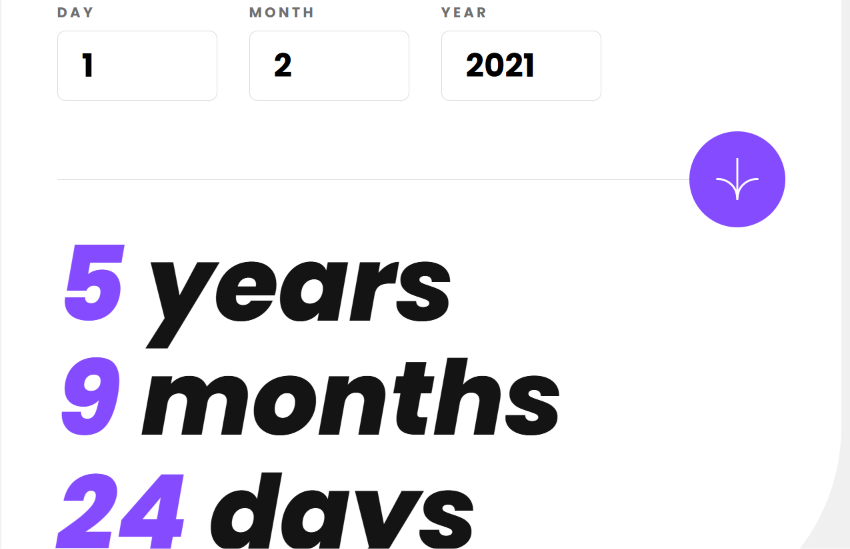

# Frontend Mentor - Age calculator app

My solution to the [Age calculator app challenge](https://www.frontendmentor.io/challenges/age-calculator-app-dF9DFFpj-Q) on Frontend Mentor.

## Screenshot.png

## Features

- Enter a day, month, and year and see your age in years, months, and days
- Validation for empty fields, invalid days and months, invalid dates like 31/04, and dates in the future
- Animated result numbers
- Responsive layout for mobile and desktop
- Hover and focus states on all interactive elements

## Built with

- TypeScript
- Tailwind CSS
- Vite
- Semantic HTML5
- Mobile-first workflow

## Run it locally

`bash
npm install
npm run dev

 Then open the `local host` link shown in the terminal

## author
GitHub - [@sefahanan449-byte](http://github.com/sefahanan449-byte)

